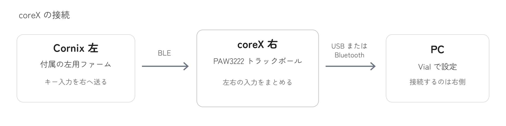

# CoreX Proto RMK

**組み立て・左側の書き込みが済んだら、[左右を接続する手順](docs/pairing.md)へ進んでください。** 出荷品の右は書き込み済みなので、そのまま使えます。

## 1. ファームをダウンロードする

- **[左用ファーム — v0.10.1](https://github.com/yuchamichami/CoreX-Proto-RMK/releases/download/v0.10.1/CoreX-Left-v0.10.1.uf2)**：純正Cornix左用

**出荷品の右は書き込み済みです。初めて使うときに書き換えるのは左だけです。** これから基板を交換する場合は、先に[写真付きの組み立てガイド](docs/assembly.md)を進めてください。

右の更新が必要な方は、[対応する接続先と更新手順](docs/flashing.md#corex-を更新する)を確認してください。配布中の右用は「ボールに近い側」のコネクター用なので、「ボールから遠い側」を使う出荷品には書き込まないでください。

## 2. 左だけに書き込む

書き換える前に、純正Cornixの左をUSB接続し、[Vial](https://get.vial.today/)の **File → Save current layout** で今の配列を保存します。

左にCoreX用v0.10.1が入っている場合は、書き換えず次へ進めます。

1. **左だけ**をデータ通信できるUSBケーブルでPCにつなぎ、RESETを素早く2回押します。
2. 表示されたUSBドライブに **`CoreX-Left-v0.10.1.uf2`** をコピーします。自動で再起動してドライブが消えたら、左のUSBを抜きます。

ドライブ名は `NO NAME`、`NRF52BOOT` など個体によって異なります。[書き込みの詳細・旧版からの更新](docs/flashing.md)

## 3. 左右をペアリングする

充電した左右を近くに置いて電源を続けてONにし、右だけをPCへUSB接続します。左右は自動でペアリングするので、数秒待ってから文字キーを押し、左右どちらからも入力できることを確認します。

**[詳しいペアリング手順](docs/pairing.md)を別ページにまとめています。** キー位置の図と、つながらない場合のリセット手順も載せています。

## 4. PCとBluetoothでペアリングする

**先に、右のUSB接続を通して左の文字入力ができることを確認してください。** USBで使う場合は、右をPCにつないだまま次へ進めます。 Bluetoothで使う場合は、左右に充電済みの電池をつなぎ、電源をONにします。

以下は初期配列での操作です。Vialで変更した割り当ては残るため、変更済みの場合は自分で割り当てたBluetoothキーと登録先1のキーを使います。

1. 左親指の中央にある **Bluetoothキー** を押しながら、左の **Caps Lock** を短く押して離します。PCの登録先1を選び、未登録なら登録待ちになります。
2. PCのBluetooth設定で **`Cornix TB`** を選んで接続します。
3. 右のUSBを抜き、次の操作確認へ進みます。

[キーの位置](docs/usage.md#初期配列) · [2台目以降のPCを登録・切り替える](docs/usage.md#接続する-pc-を切り替える)

同じPCに登録済みなら、登録し直す必要はありません。v0.9.4以前からの更新や「候補には出るが接続できない」場合は、[PCの登録をやり直します](docs/usage.md#pc-の登録をやり直す)。

## 5. 操作を確認する

初期配列では、次の操作ができます。更新前にVialで変更した配列は引き継がれます。

- **文字入力：** 左右のキーを押します。
- **ポインター移動：** ボールを回します。
- **クリック：** ボールを動かした直後に、Jで左クリック、Kで中クリック、Lで右クリックします。
- **スクロール：** Iを長押ししながらボールを回します。Iを短く押すと文字のIを入力します。
- **エンコーダ：** 右はスクロールと中クリック、左は音量調整とミュートです。

ここまで動けば、使い始められます。キー配列や感度を変える場合は、右をUSB接続してVialの **`Cornix TB`** を選びます（アプリでは **`CoreX Cornix TB`** と表示されます）。[画像付きの設定手順](docs/usage.md#vial-で変更する)

## 設定・補足

- [初期配列とFnキー](docs/usage.md#初期配列)
- [トラックボールの感度・スクロール量・AMLを変更する](docs/usage.md#trackball-settings)
- [クリックへの自動切り替え（AML）の動き](docs/usage.md#クリックへの自動切り替えaml)：ボールを止めて約0.7秒でJ・K・Lが通常の文字入力に戻ります。
- [LED表示](docs/usage.md#led表示)：接続と電池低下を短い点滅で知らせ、普段は消灯します。
- [電池残量](docs/usage.md#電池残量)：PCには右の推定残量を表示し、左の残量低下は右のLEDで知らせます。
- [スリープと復帰](docs/usage.md#スリープと復帰)：5分間操作しないと待機に入り、キーやボールで復帰します。
- [配列の保存・読み込み](docs/usage.md#配列の保存と読み込み)

### 純正Cornixとの違い・対応範囲

PCにつなぐのはCoreX右で、左側にもこのリポジトリのファームが必要です。通常キーと数字・記号のFn配列は純正を基にしています。CoreX右と純正Cornix右のファームは互換性がありません。

配布中の右用v0.10.1は、右のボールに近い側のコネクターに接続するPAW3222用です。ボールから遠い側のコネクターを使う出荷品は、書き込み済みの右ファームをそのまま使います。トラックポイントとタッチパッドには対応していません。PCには右のUSBまたはBluetoothで接続します。純正の無線ドングルとの接続は未確認です。

## 困ったとき

- [左だけ反応しない・Vialに出ない・クリックやスクロールができない](docs/usage.md#困ったとき)
- [PCのBluetooth登録をやり直す](docs/usage.md#pc-の登録をやり直す)
- [左右の登録をやり直す](docs/usage.md#左右の登録をやり直す)
- [RESETと登録削除の違い](docs/usage.md#再起動と登録削除)
- [純正Cornix左のファームへ戻す](docs/flashing.md#純正-cornix-左へ戻す)
- [不具合を報告する](docs/usage.md#解決しない場合)

## 資料

[開発資料](docs/development.md) · [ライセンスと使用ライブラリ](docs/THIRD_PARTY_NOTICES.md)

[RMK](https://github.com/rmk-rs/rmk)をベースにしています。Cornixメーカーの公式ファームウェアではありません。
