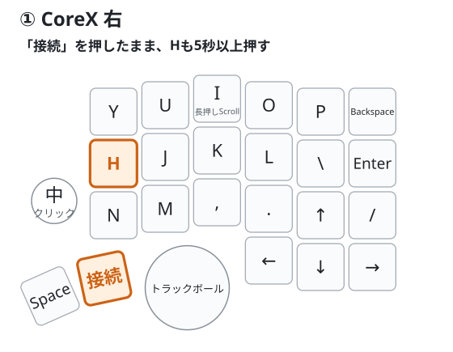
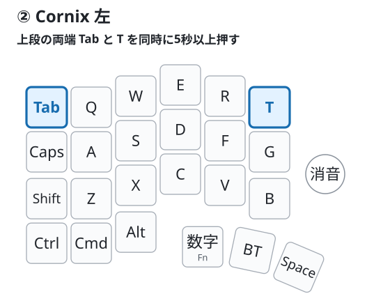

# 左右を接続する

[組み立て](assembly.md)と[左側の書き込み](flashing.md#純正-cornix-左を初めて使う)を済ませてから始めます。出荷時に書き込み済みの右は、そのまま使ってください。

## 初めて接続する

1. 充電した左右を近くに置き、**左右の電源を続けてONにします。** 左右は自動でペアリングします。
2. **右だけをPCにUSB接続します。左のUSBは抜いておきます。**
3. 数秒待ってからPCでメモ帳などを開き、左右それぞれの好きな文字キーを押します（右のY、左のAなど）。

**左右どちらからも文字を入力できれば完了です。** ランプは普段は消えていて構いません。

USBで使う場合は、そのまま使えます。無線で使う場合は、続けて[PCとのBluetooth接続](usage.md#pc-と-bluetooth-接続する)へ進みます。次回からも、左右の電源をONにすれば接続できます。

## 上記の手順でうまくいかない場合

右は入力できるのに左が反応しない場合は、**左右のペアリング情報をリセットしてから、接続し直します。** 右のUSBはつないだまま、左右の電源をONにして操作してください。ほかのCoreXが近くにある場合は、その電源をOFFにしてUSBも抜きます。

### 1. 右のペアリング情報をリセットする

右親指の2つのキーのうち、**トラックボールに近い方**が「接続」キーです。キーキャップに印字がなくても、図の位置で確認してください。

1. 右親指の接続キーを押し、そのまま押し続けます。
2. 接続キーを押したまま、**Hも5秒以上押し続けます。**
3. Hを離し、接続キーも離します。

長押し中は、ほかのキーやエンコーダを操作しないでください。右のランプ2個が同時に3回点滅するのが目印です。

**操作後は間を空けず、60秒以内に次の左の操作へ進みます。**

### 2. 左のペアリング情報をリセットする

1. 左の上段の両端、**TabとTを同時に5秒以上押し続けます。**
2. 両方のキーを離して、数秒待ちます。

左のランプ2個が青で3回点滅するのが目印です。左右は自動で接続し直します。すでに左から文字が入力できる場合、この操作は不要です。

### 3. 好きな文字キーを押して確認する

すべてのキーを離してから、メモ帳などで左の好きな文字キーを押します（Aなど）。**左から文字を入力できれば完了です。** 点滅を見逃しても、入力できれば接続できています。

この操作でキー配列やPCとの接続設定は消えません。毎回リセットする必要もありません。

右からも入力できない場合や、ここまで試してもつながらない場合は、[左右がつながらないとき](pairing-help.md)を確認してください。
